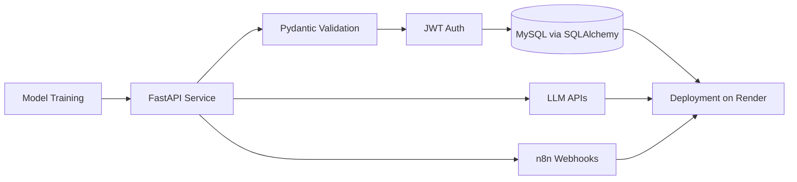

 

  

 

<!-- ───────────────────────── ABOUT ───────────────────────── -->

<h2 align="center">👋 About Me</h2>

<table width="100%">
  <tr>
    <td valign="top" width="58%">

I'm a final-year **Computer Science and Engineering** student at **Uttara University**, Gazipur, Bangladesh, building toward a career in **AI/ML engineering**.

What I enjoy most is taking a trained model and turning it into a real product: a clean **backend API**, a polished interface, and a **live deployment** that people can actually use.

I also care about **AI/ML applications built for Bangladesh**, where practical, deployable solutions can make a real difference.

</td>
    <td valign="top" width="42%">

**🔭 Right now**

- ⚡ Building FastAPI backends with auth and databases
- 🤖 Developing LLM and multi-agent apps with LangChain
- 📘 Deepening Deep Learning and TypeScript

**🤝 Open to**

- 🎓 Internships
- 💼 Junior AI/ML and backend roles
- 🚀 Collaboration on practical AI products

</td>
  </tr>
</table>

 

<!-- ───────────────────────── TECH STACK ───────────────────────── -->

<h2 align="center">🧰 Tech Stack</h2>

<table width="100%">
  <tr>
    <td align="center" width="16%"> <b>Python</b></td>
    <td align="center" width="16%"> <b>TypeScript</b></td>
    <td align="center" width="16%"> <b>JavaScript</b></td>
    <td align="center" width="16%"> <b>C++</b></td>
    <td align="center" width="16%"> <b>HTML5</b></td>
    <td align="center" width="16%"> <b>CSS3</b></td>
  </tr>
</table>

<table width="100%">
  <tr>
    <td align="center" width="16%"> <b>FastAPI</b></td>
    <td align="center" width="16%"> <b>MySQL</b></td>
    <td align="center" width="16%"> <b>SQLAlchemy</b></td>
    <td align="center" width="16%"> <b>Pydantic</b></td>
    <td align="center" width="16%"> <b>JWT Auth</b></td>
    <td align="center" width="16%"> <b>REST APIs</b></td>
  </tr>
</table>

<table width="100%">
  <tr>
    <td align="center" width="20%"> <b>LangChain & LangGraph</b></td>
    <td align="center" width="20%"> <b>Gemini</b></td>
    <td align="center" width="20%"> <b>n8n</b></td>
    <td align="center" width="20%"> <b>ChromaDB (RAG)</b></td>
    <td align="center" width="20%"> <b>Streamlit</b></td>
  </tr>
</table>

<table width="100%">
  <tr>
    <td align="center" width="25%"> <b>Scikit-learn</b></td>
    <td align="center" width="25%"> <b>TensorFlow</b></td>
    <td align="center" width="25%"> <b>Pandas</b></td>
    <td align="center" width="25%"> <b>NumPy</b></td>
  </tr>
</table>

<table width="100%">
  <tr>
    <td align="center" width="20%"> <b>Git</b></td>
    <td align="center" width="20%"> <b>GitHub</b></td>
    <td align="center" width="20%"> <b>Render</b></td>
    <td align="center" width="20%"> <b>Postman</b></td>
    <td align="center" width="20%"> <b>VS Code</b></td>
  </tr>
</table>

 

<!-- ───────────────────────── BACKEND ───────────────────────── -->

<h2 align="center">⚙️ Backend Engineering</h2>

Most of my ML projects are built around a proper backend rather than a notebook. This is the architecture I usually follow:

<table width="100%">
  <tr>
    <td width="50%" valign="top">
      <h4>🧩 API Design</h4>
      Clean REST endpoints with typed request and response validation.
    </td>
    <td width="50%" valign="top">
      <h4>🔐 Security</h4>
      JWT-based authentication and protected routes.
    </td>
  </tr>
  <tr>
    <td width="50%" valign="top">
      <h4>🗄️ Data Layer</h4>
      MySQL databases with SQLAlchemy models and structured persistence.
    </td>
    <td width="50%" valign="top">
      <h4>🚢 Integration & Delivery</h4>
      LLM APIs and n8n webhooks connecting frontend, backend and automation, deployed live with environment-based configuration.
    </td>
  </tr>
</table>

 

<!-- ───────────────────────── PROJECTS ───────────────────────── -->

<h2 align="center">🚀 Featured Projects</h2>

<table width="100%">
  <tr>
    <td width="50%" valign="top">
      <h3>🔬 Promptica-AI</h3>
      
Multi-agent research system with search, reader, writer and critic stages, built with LangChain, Gemini and Tavily, with a Streamlit interface.

      
      
      
      
      
<a href="https://github.com/prethul/AI-Powered-Multi-Agent-Research-System"><b>📂 View repository</b></a>

    </td>
    <td width="50%" valign="top">
      <h3>🏥 Medi-Hub</h3>
      
AI healthcare booking platform with a symptom chatbot, structured output parsing, Google Sheets logging and automated Gmail confirmations, orchestrated with n8n.

      
      
      
      
<a href="https://medi-hub-ai-automated-booking-system1.onrender.com"><b>🌐 Live demo</b></a>

    </td>
  </tr>
  <tr>
    <td width="50%" valign="top">
      <h3>📅 Daily RoutineHub</h3>
      
FastAPI backend with JWT authentication, SQLAlchemy models, Gemini AI integration and gamification features.

      
      
      
      
    </td>
    <td width="50%" valign="top">
      <h3>🚚 Bangladesh Delivery Time Prediction</h3>
      
ML-powered delivery estimation with a FastAPI backend and an interactive Leaflet.js map.

      
      
      
    </td>
  </tr>
  <tr>
    <td width="50%" valign="top">
      <h3>🚢 Titanic Survival Prediction</h3>
      
Deployed ML web application that predicts passenger survival from a trained model.

      
      
      
<a href="https://titanic-prediction-ai.onrender.com"><b>🌐 Live demo</b></a>

    </td>
    <td width="50%" valign="top">
      <h3>🧠 Generative-AI</h3>
      
A module-by-module learning path through LLMs, prompt engineering, chains, runnables, document loaders and tools in LangChain.

      
      
      
      
<a href="https://github.com/prethul/Generative-AI"><b>📂 View repository</b></a>

    </td>
  </tr>
</table>

<b>📦 More projects</b>

 

| Project | What it does |
| :-- | :-- |
| **Multi-Disease Prediction** | Streamlit app serving several trained ML models |
| **Fake Currency Detection** | Wavelet feature extraction based classifier |
| **Crop Recommendation** | ML recommendation app for farmers |
| **FIFA World Cup 2026 Predictor** | Elo ratings combined with Poisson regression |
| **AI Meeting Assistant** | Whisper transcription, LangChain, ChromaDB RAG and Streamlit |
| **Piku AI Shop** | E-commerce site with n8n webhook order processing |

 

 

<!-- ───────────────────────── GITHUB STATS ───────────────────────── -->

<h2 align="center">📊 GitHub Activity</h2>

<picture>
  <source media="(prefers-color-scheme: dark)" srcset="https://github-readme-stats.vercel.app/api?username=prethul&show_icons=true&theme=tokyonight&hide_border=true&count_private=true&bg_color=0d1117" />
  <source media="(prefers-color-scheme: light)" srcset="https://github-readme-stats.vercel.app/api?username=prethul&show_icons=true&theme=default&hide_border=true&count_private=true" />
  
</picture>
<picture>
  <source media="(prefers-color-scheme: dark)" srcset="https://github-readme-stats.vercel.app/api/top-langs/?username=prethul&layout=compact&theme=tokyonight&hide_border=true&bg_color=0d1117" />
  <source media="(prefers-color-scheme: light)" srcset="https://github-readme-stats.vercel.app/api/top-langs/?username=prethul&layout=compact&theme=default&hide_border=true" />
  
</picture>

 

<picture>
  <source media="(prefers-color-scheme: dark)" srcset="https://streak-stats.demolab.com?user=prethul&theme=tokyonight&hide_border=true&background=0d1117" />
  <source media="(prefers-color-scheme: light)" srcset="https://streak-stats.demolab.com?user=prethul&theme=default&hide_border=true" />
  
</picture>

 

<picture>
  <source media="(prefers-color-scheme: dark)" srcset="https://github-readme-activity-graph.vercel.app/graph?username=prethul&theme=tokyo-night&hide_border=true&area=true" />
  <source media="(prefers-color-scheme: light)" srcset="https://github-readme-activity-graph.vercel.app/graph?username=prethul&theme=minimal&hide_border=true&area=true" />
  
</picture>

 

<!-- ───────────────────────── CONNECT ───────────────────────── -->

<h2 align="center">💬 Let's Connect</h2>

If you are building something in **AI, backend or automation**, I would love to hear about it.

 

  

⭐ If you like my work, consider starring a repository. Thanks for visiting!

