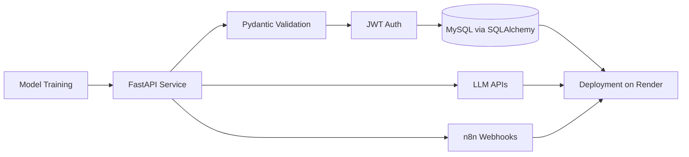

  
  
  
  

---

## About Me

<table>
  <tr>
    <td valign="top" width="60%">

I am a final-year **Computer Science and Engineering** student at **Uttara University**, Gazipur, Bangladesh, building toward a career in **AI/ML engineering**.

What I enjoy most is taking a trained model and turning it into a real product: a clean **backend API**, a polished interface, and a live deployment that people can actually use.

I also care about **AI/ML applications built for Bangladesh**, where practical, deployable solutions can make a real difference.

</td>
    <td valign="top" width="40%">

**Right now**

- Building FastAPI backends with auth and databases
- Developing LLM and multi-agent apps with LangChain
- Deepening Deep Learning and TypeScript

**Open to**

- Internships
- Junior AI/ML and backend roles
- Collaboration on practical AI products

</td>
  </tr>
</table>

---

## Tech Stack

**Languages**

**Backend and Databases**

**Generative AI and Automation**

**Machine Learning and Data**

**Tools and Deployment**

---

## Backend Engineering

Most of my ML projects are built around a proper backend rather than a notebook. This is the architecture I usually follow:

<table>
  <tr>
    <td width="50%" valign="top">
      <h4>API Design</h4>
      Clean REST endpoints with typed request and response validation.
    </td>
    <td width="50%" valign="top">
      <h4>Security</h4>
      JWT-based authentication and protected routes.
    </td>
  </tr>
  <tr>
    <td width="50%" valign="top">
      <h4>Data Layer</h4>
      MySQL databases with SQLAlchemy models and structured persistence.
    </td>
    <td width="50%" valign="top">
      <h4>Integration and Delivery</h4>
      LLM APIs and n8n webhooks connecting frontend, backend and automation, deployed live with environment-based configuration.
    </td>
  </tr>
</table>

---

## Featured Projects

<table>
  <tr>
    <td width="50%" valign="top">
      <h3>Promptica-AI</h3>
      
Multi-agent research system with search, reader, writer and critic stages, built with LangChain, Gemini and Tavily, with a Streamlit interface.

      
<code>LangChain</code> <code>LangGraph</code> <code>Gemini</code> <code>Streamlit</code>

      <a href="https://github.com/prethul/AI-Powered-Multi-Agent-Research-System"><b>View repository</b></a>
    </td>
    <td width="50%" valign="top">
      <h3>Medi-Hub</h3>
      
AI healthcare booking platform with a symptom chatbot, structured output parsing, Google Sheets logging and automated Gmail confirmations, orchestrated with n8n.

      
<code>n8n</code> <code>LLM</code> <code>Automation</code>

      <a href="https://medi-hub-ai-automated-booking-system1.onrender.com"><b>Live demo</b></a>
    </td>
  </tr>
  <tr>
    <td width="50%" valign="top">
      <h3>Daily RoutineHub</h3>
      
FastAPI backend with JWT authentication, SQLAlchemy models, Gemini AI integration and gamification features.

      
<code>FastAPI</code> <code>JWT</code> <code>SQLAlchemy</code> <code>Gemini</code>

    </td>
    <td width="50%" valign="top">
      <h3>Bangladesh Delivery Time Prediction</h3>
      
ML-powered delivery estimation with a FastAPI backend and an interactive Leaflet.js map.

      
<code>FastAPI</code> <code>Machine Learning</code> <code>Leaflet.js</code>

    </td>
  </tr>
  <tr>
    <td width="50%" valign="top">
      <h3>Titanic Survival Prediction</h3>
      
Deployed ML web application that predicts passenger survival from a trained model.

      
<code>Scikit-learn</code> <code>Render</code>

      <a href="https://titanic-prediction-ai.onrender.com"><b>Live demo</b></a>
    </td>
    <td width="50%" valign="top">
      <h3>Generative-AI</h3>
      
A module-by-module learning path through LLMs, prompt engineering, chains, runnables, document loaders and tools in LangChain.

      
<code>LangChain</code> <code>Python</code> <code>Jupyter</code>

      <a href="https://github.com/prethul/Generative-AI"><b>View repository</b></a>
    </td>
  </tr>
</table>

<b>More projects</b>

 

- **Multi-Disease Prediction:** Streamlit app serving several trained ML models
- **Fake Currency Detection:** wavelet feature extraction based classifier
- **Crop Recommendation:** ML recommendation app for farmers
- **FIFA World Cup 2026 Predictor:** Elo ratings combined with Poisson regression
- **AI Meeting Assistant:** Whisper transcription, LangChain, ChromaDB RAG and Streamlit
- **Piku AI Shop:** e-commerce site with n8n webhook order processing

<a href="https://github.com/prethul?tab=repositories"><b>Browse all repositories</b></a>

---

## GitHub Activity

<picture>
  <source media="(prefers-color-scheme: dark)" srcset="https://github-readme-stats.vercel.app/api?username=prethul&show_icons=true&theme=tokyonight&hide_border=true&count_private=true" />
  <source media="(prefers-color-scheme: light)" srcset="https://github-readme-stats.vercel.app/api?username=prethul&show_icons=true&theme=default&hide_border=true&count_private=true" />
  
</picture>
<picture>
  <source media="(prefers-color-scheme: dark)" srcset="https://github-readme-stats.vercel.app/api/top-langs/?username=prethul&layout=compact&theme=tokyonight&hide_border=true" />
  <source media="(prefers-color-scheme: light)" srcset="https://github-readme-stats.vercel.app/api/top-langs/?username=prethul&layout=compact&theme=default&hide_border=true" />
  
</picture>

<picture>
  <source media="(prefers-color-scheme: dark)" srcset="https://github-readme-activity-graph.vercel.app/graph?username=prethul&theme=tokyo-night&hide_border=true" />
  <source media="(prefers-color-scheme: light)" srcset="https://github-readme-activity-graph.vercel.app/graph?username=prethul&theme=minimal&hide_border=true" />
  
</picture>

---

## Let's Connect

If you are building something in AI, backend or automation, I would love to hear about it.

